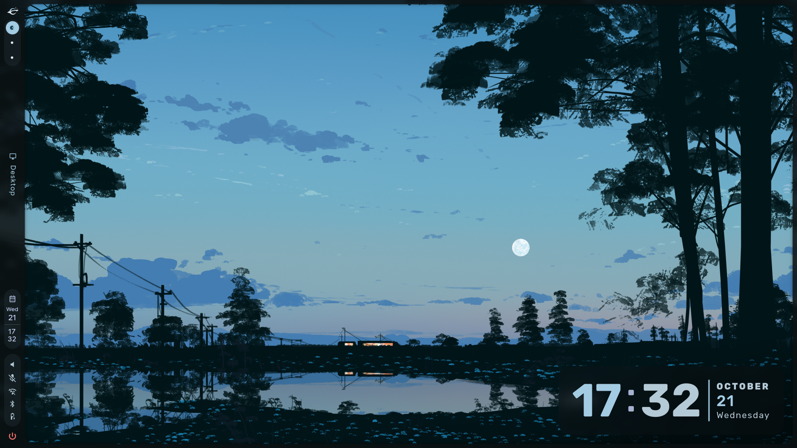
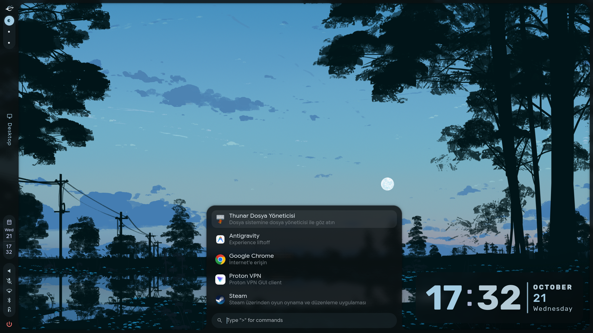
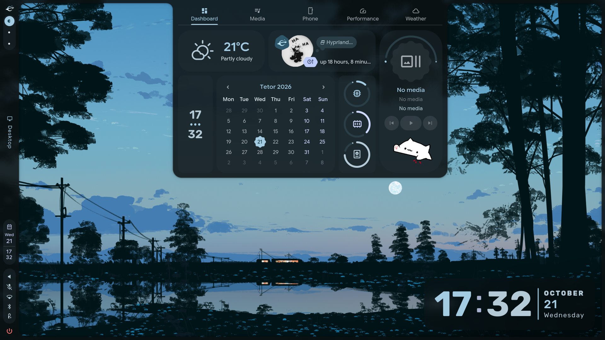
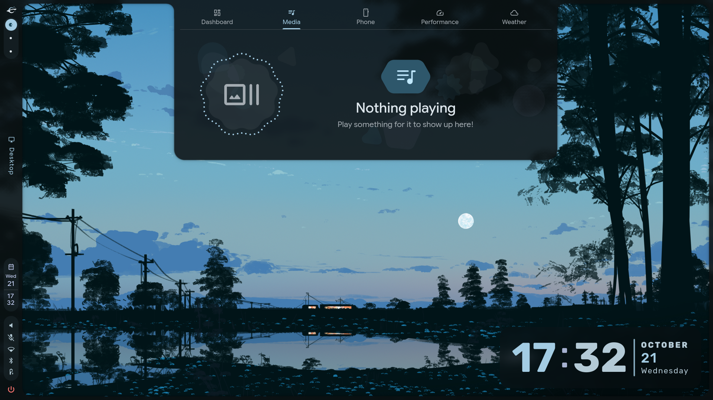
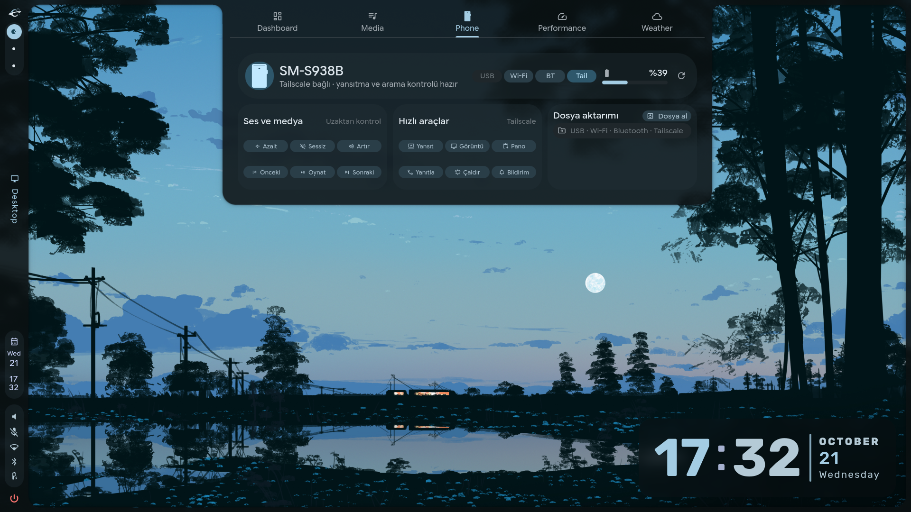
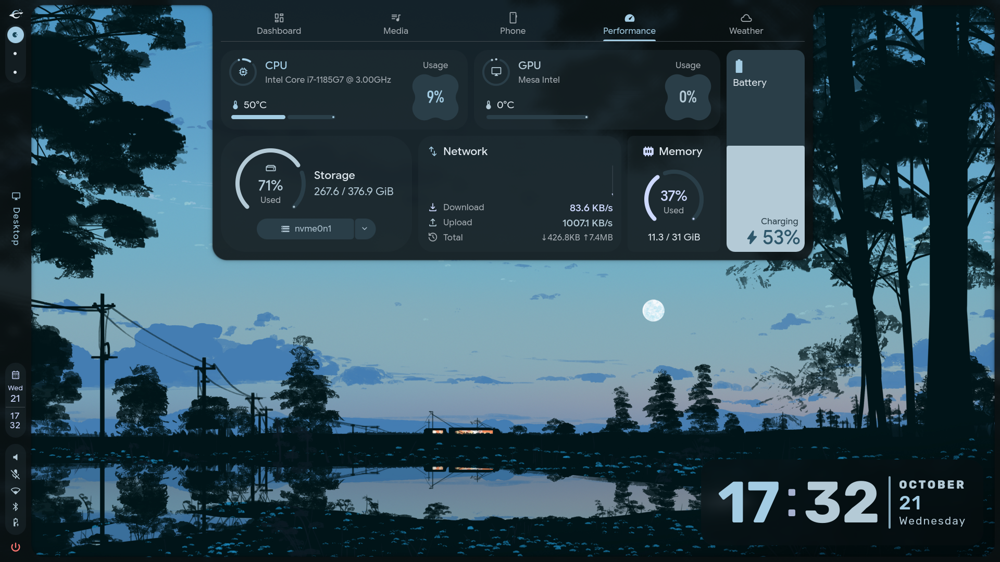
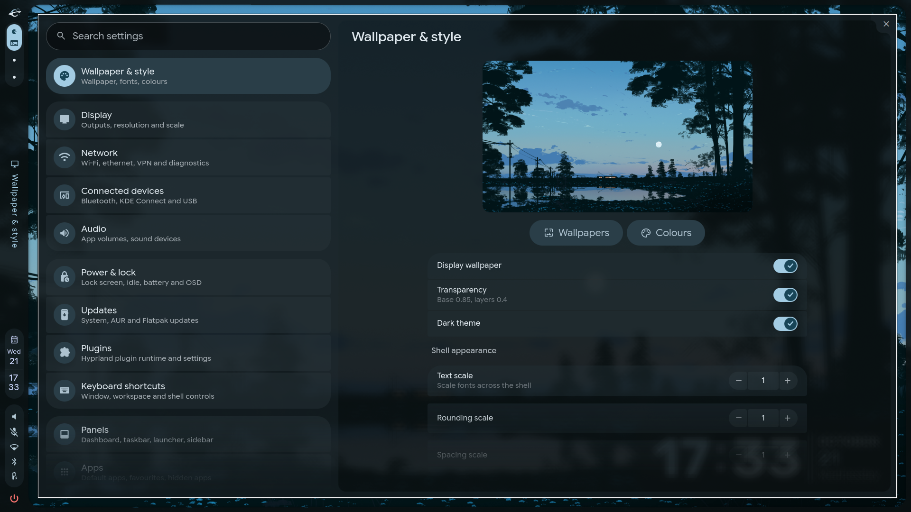
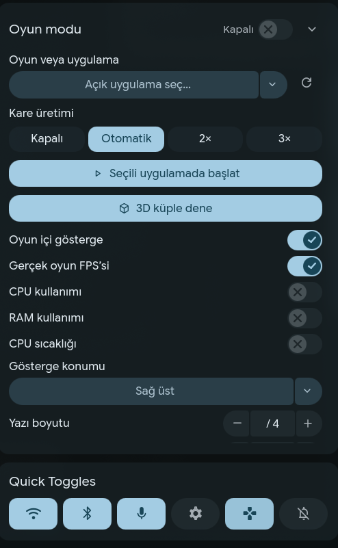

# Atom Shell

**English** | [Türkçe](README.tr.md)

Atom Shell is a modern, responsive desktop shell and configuration framework for [Hyprland](https://hyprland.org), built on top of [Quickshell](https://github.com/outfoxxed/quickshell) and the Caelestia architecture.

It combines pure QML desktop modules, an interactive 15-page control center, phone automation, Tailscale mesh connectivity, advanced power and low-battery hibernation handling, and game mode optimization into a single, cohesive desktop environment.

---

## 📸 Screenshots & Desktop Components

All screenshots are captured natively at 1080p from a clean installation.

| Desktop Bar & Workspaces | Application Launcher |
|:---:|:---:|
|  |  |

| Dashboard Overview | Dashboard Media & Lyrics |
|:---:|:---:|
|  |  |

| Phone Integration | System Performance HUD |
|:---:|:---:|
|  |  |

| Nexus Settings Center | In-Game Performance Panel |
|:---:|:---:|
|  |  |

---

## ✨ Features

- **🌐 Comprehensive Bilingual UI:** Full English and Turkish support across all QML modules (`qsTr()` catalogs and live language switching in Nexus).
- **🎨 Material You Dynamic Theming:** Wallpaper-derived color schemes, custom accent palettes, blur, and opacity controls.
- **⚙️ Nexus Control Center:** 15 modular setting panels managing displays, networks, Bluetooth, audio, power, updates, plugins, shortcuts, and apps.
- **🎮 Game Mode & Frame Generation:** Real-time FPS overlay HUD, direct scanout passthrough, GPU/CPU performance governor, and 3D test cube.
- **📱 Phone & Tailscale Integration:** Live battery state, drag-and-drop file transfers, scrcpy screen mirroring, remote call answering, and mesh discovery.
- **🔋 Graceful Low-Battery Hibernation:** Multi-stage countdown and secure snapshot to disk before battery exhaustion.
- **⌨️ Ergonomic Keyboard Shortcuts:** Interactive search HUD (`F12` / `Super + Shift + H`) and conflict-free Hyprland Lua keybindings.
- **🛡️ Safe Setup & Rollbacks:** Automated interactive installer, zero data loss policy, timestamped backups, and non-destructive configuration merges.

---

## 💻 Supported Distributions

| Distribution | Runtime | Support Level |
|---|---|---|
| **Arch Linux** | Native Qt 6.9+, Quickshell | Tier 1 (Full Native) |
| **CachyOS** | Native Qt 6.9+, Quickshell | Tier 1 (Full Native) |
| **Debian 13/14** | Nix runtime + apt integration | Supported |
| **Ubuntu / Linux Mint** | Nix runtime + apt integration | Supported (Requires Hyprland 0.55+) |

For distribution-specific prerequisites and details, refer to the [Distribution Guide](docs/DISTROS.md).

---

## 🚀 Quick Start & Installation

Atom Shell provides an automated, interactive installation script with dependency checks:

```bash
git clone https://github.com/aToom13/Atom-Shell.git
cd Atom-Shell

# Interactive installation wizard
./setup.sh
```

Alternatively, you can run `./install.sh` with granular command-line flags:

```bash
# Preview actions without modifying system files
./install.sh --dry-run

# Non-interactive automated install
./install.sh --non-interactive --config-mode merge
```

### Post-Installation & Health Check

Run the built-in diagnostic tool to verify all components and dependencies:

```bash
atomshell doctor
```

---

## 🕹️ Shell Management CLI

The `atomshell` management utility is installed to `~/.local/bin/atomshell`:

```bash
atomshell start      # Launch Atom Shell in background
atomshell stop       # Safely stop active shell instance
atomshell restart    # Reload and restart shell components
atomshell nexus      # Open Nexus Control Center
atomshell doctor     # Run dependency and health diagnostics
atomshell log        # Stream live quickshell logs
```

---

## 📚 Modular Documentation

Detailed topics and technical guides are split into dedicated documents:

- ⚙️ **[Nexus Control Center Guide](docs/nexus.md):** Deep dive into the 15 control pages and configuration state.
- 🎮 **[Game Mode & Optimization Guide](docs/game-mode.md):** Frame Generation, in-game HUD, VRR, and test cube.
- 📱 **[Phone & Tailscale Integration](docs/phone-tailscale.md):** KDE Connect, wireless ADB, clipboard sync, and SSH automation.
- ⌨️ **[Keyboard Shortcuts Guide](docs/shortcuts.md):** Window tiling, special workspaces, and shortcut search HUD.
- 🏗️ **[Architecture & Runtime](docs/ARCHITECTURE.md):** Quickshell lifecycle, IPC mechanisms, and configuration hierarchy.
- 🐧 **[Distribution Notes](docs/DISTROS.md):** Platform requirements, package lists, and Nix runtime details.

---

## 📜 License & Attribution

This project is licensed under the GNU General Public License v3.0 (GPL-3.0). See [LICENSE](LICENSE) for details. Upstream Caelestia Shell architecture and contributors are acknowledged and preserved.
